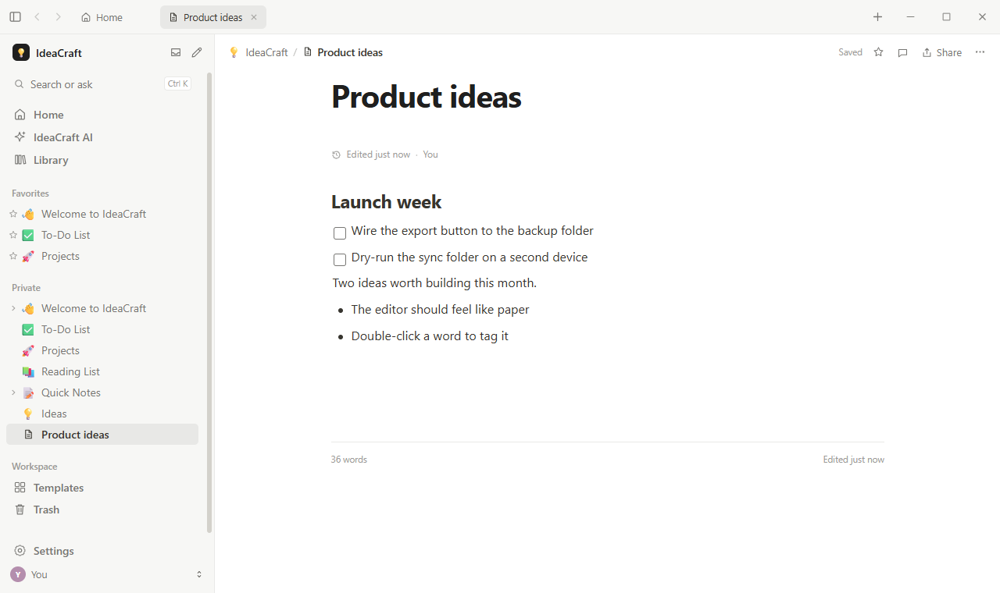
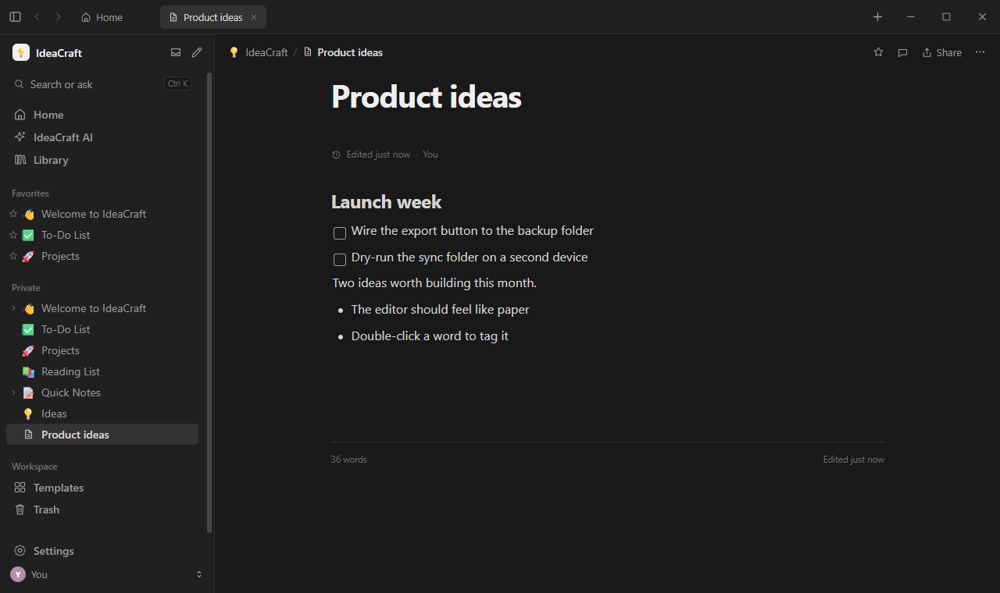
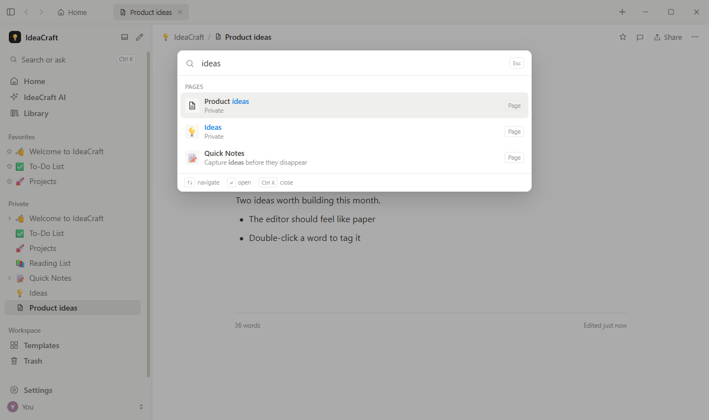

# IdeaCraft

**A local-first workspace for notes, docs, projects and knowledge.**

IdeaCraft is a fast, offline-friendly, desktop app for Windows — and the same source
tree compiles on Linux and macOS ([Build from source](#build-from-source)).
Pages live in a local SQLite database, the interface is plain HTML/CSS/JS rendered by
the system WebView2 (WebKitGTK/WebKit on Linux/macOS), and the app itself is a compact
Rust binary — your words never leave your machine unless you turn on sync.

- ~7 MB install, starts in under a second, no background services
- Block editor (headings, lists, to-dos, quotes, code, dividers), Markdown shortcuts
- Favorites, trash, page history, page icons & covers
- Search, templates, data export/backup, device-to-device sync folder
- Optional AI assistant via a local Ollama endpoint (off by default)
- Dark/light/system themes

## Screenshots

One page, three views of the app — the editor in both themes, and the `Ctrl K`
search palette over it:

<p align="center">
  
  
</p>
<p align="center">
  
</p>

## Install on a PC

The one-command install (Windows 10/11):

```
npm install -g ideacraft
```

That's it. The package's postinstall step downloads the latest **signed** installer from
GitHub Releases and runs it **silently** for the current user — no admin rights, no UAC
prompt. It installs to `%LOCALAPPDATA%\IdeaCraft`, creates Start Menu & Desktop shortcuts,
and pulls in the WebView2 runtime automatically if Windows is missing it.

(`npm install ideacraft` works too; `-g` additionally makes the `ideacraft` launcher
command available everywhere.)

After it finishes, launch the app any way you like:

- the **IdeaCraft** Start Menu / Desktop shortcut, or
- from a terminal: `ideacraft` (or `npx ideacraft` for a local install)

The launcher package also supports:

| Command               | Action                                           |
| --------------------- | ------------------------------------------------ |
| `ideacraft install`   | (Re)install or repair the silent app install      |
| `ideacraft uninstall` | Remove the installed app                          |
| `ideacraft where`     | Print the installed app path                      |

**Environment overrides:** `IDEACRAFT_SKIP_INSTALL=1` (skip the download),
`IDEACRAFT_REPO=owner/name` (install from another repo), `IDEACRAFT_STRICT=1` (fail
`npm install` when the app installer fails instead of warning).

**Direct download:** grab `IdeaCraft_<version>_x64-setup.exe` from
[GitHub Releases](https://github.com/aamirenic/IdeaCraft/releases) and run it
manually if you prefer not to use npm.

> **SmartScreen note:** the app is not code-signed with a paid certificate yet, so Windows
> SmartScreen may show "Windows protected your PC" on first manual launch of the exe.
> Choose *More info → Run anyway*; the npm/NSIS install path installs the app normally and
> uses the same trusted WebView2 runtime.

## Requirements

- Windows 10 (1809+) or Windows 11
- [Node.js](https://nodejs.org) 18+ for the npm install path (or nothing at all if you
  run the installer from GitHub Releases directly)

## Build from source

IdeaCraft is a [Tauri 2](https://tauri.app) app — a compact Rust binary around the plain
HTML/CSS/JS frontend in `ui/` (embedded at build time; there is no separate frontend
build step). Prebuilt releases ship for Windows, but the source builds on all three
major desktop platforms.

### Windows

Prerequisites: [Rust](https://rustup.rs) 1.80+ and Node.js 18+.

```bash
git clone https://github.com/aamirenic/IdeaCraft
cd ideacraft
npm install            # installs @tauri-apps/cli + playwright-core dev tooling
npm run build          # = npx tauri build (release, embedded UI, NSIS bundle)
```

Artifacts land in:

- `src-tauri/target/release/bundle/nsis/IdeaCraft_<version>_x64-setup.exe` (installer)
- `src-tauri/target/release/ideacraft.exe` (portable exe)

### Linux

Same Rust/Node prerequisites, plus the system libraries Tauri needs (WebKitGTK, tray,
rsvg). First-time setup:

```bash
# Debian / Ubuntu
sudo apt update
sudo apt install -y libwebkit2gtk-4.1-dev build-essential curl wget file \
  libxdo-dev libssl-dev libayatana-appindicator3-dev librsvg2-dev

# Fedora
sudo dnf install -y webkit2gtk4.1-devel gtk3-devel libappindicator-gtk3-devel \
  librsvg2-devel xdotool-devel openssl-devel

# Arch
sudo pacman -S --needed webkit2gtk-4.1 gtk3 libappindicator-gtk3 librsvg \
  xdotool openssl base-devel
```

Then build the Linux bundles (the configured bundle target is NSIS, which is
Windows-only — on Linux always pass `--bundles`):

```bash
npm install
npm run build -- --bundles deb,appimage
```

Artifacts land in:

- `src-tauri/target/release/ideacraft` (portable Linux binary)
- `src-tauri/target/release/bundle/deb/IdeaCraft_<version>_amd64.deb`
- `src-tauri/target/release/bundle/appimage/IdeaCraft_<version>_amd64.AppImage`

### macOS

Prerequisites: [Rust](https://rustup.rs) 1.80+, Node.js 18+ and the Xcode Command Line
Tools (`xcode-select --install`).

```bash
npm install
npm run build -- --bundles app     # .app you can drag into /Applications
# or, to also get a disk-image installer:
# npm run build -- --bundles dmg
```

Artifacts land in:

- `src-tauri/target/release/bundle/macos/IdeaCraft.app`
- `src-tauri/target/release/bundle/dmg/IdeaCraft_<version>_<arch>.dmg` (`aarch64` on
  Apple Silicon, `x86_64` on Intel)

> One shared note: the auto-update feed signs **Windows** installers only, so self-built
> Linux/macOS binaries just don't receive update prompts — nothing in the app depends
> on them.

### Development loop (any OS)

Serve `ui/` on the dev port and run the app in debug mode (loads the live site,
hot-reloads on F5):

```bash
npx http-server ui -p 8123            # from repo root, or any static server
cargo run                             # from src-tauri/
```

## Testing

```bash
npm run smoke
```

Launches the real app with a debug port, drives the UI through the WebView2 DevTools
protocol, verifies: boot, seeded content, Ctrl+N page creation, title-Enter focus into
content, body typing, trash + delete-forever (backend + sidebar), and checks for uncaught
JS errors. The test creates and then permanently deletes its own test page; your data is
never touched. It prints a PASS/FAIL summary as JSON and exits non-zero on failure.

Set `IDEACRAFT_EXE` to test a specific build, `IDEACRAFT_CDP_PORT` to change the debug port.

## Releasing a new version

The app ships with auto-updates: a Rust-side updater plugin checks a release feed
(`latest.json`) and, on confirm from Settings → About → *Check for updates*, downloads the
signed installer and restarts the app with the new version.

If you fork or rename this repository, update its GitHub URLs in:

- `src-tauri/tauri.conf.json` (updater endpoint)
- `npm/install.js`, `npm/cli.js`, `npm/package.json` and `scripts/make-latest-json.js` (download source)
- this README

Then:

1. **Bump the version** in `src-tauri/tauri.conf.json` (and keep `src-tauri/Cargo.toml`
   and `npm/package.json` in sync).
2. **Build with signing** — set the updater signing env vars (see below), then:

   ```bash
   npm run build
   npm run latest-json     # writes src-tauri/target/release/bundle/nsis/latest.json
   ```

3. **Create a GitHub release** with tag `v<version>` and upload:
   - `IdeaCraft_<version>_x64-setup.exe` (the installer the npm package downloads)
   - `IdeaCraft_<version>_x64-setup.exe.sig` (updater signature, optional to publish)
   - `latest.json` (**required** — the updater feeds on it)
4. **Publish the npm package:**

   ```bash
   cd npm && npm publish
   ```

### Updater signing keys

The update artifacts are minisign-signed. The keypair for this project lives **outside the
repo** (in `~/.tauri/`), so nothing about it is tracked by git:

- Private key: `~/.tauri/ideacraft.key` — never copy it into the repo
- Password: keep it in a password manager or a local env file that is gitignored
- Public key: safe to publish — embedded in `tauri.conf.json` (`plugins.updater.pubkey`)

Set these when building (store them in your environment, not in the docs):

```bash
$env:TAURI_SIGNING_PRIVATE_KEY          = "$env:USERPROFILE\.tauri\ideacraft.key"
$env:TAURI_SIGNING_PRIVATE_KEY_PASSWORD = "<your key password>"
npm run build
```

> ⚠️ Losing the private key **or** its password makes future updates impossible to sign;
> users would have to reinstall manually. Back both up — but not in this repository.

## Architecture

```
IdeaCraft/
├─ ui/                 plain-JS frontend (embedded at build time via Tauri custom protocol)
│  ├─ index.html
│  ├─ styles.css
│  └─ js/              app.js, editor.js, views.js, db helpers domain modules
├─ src-tauri/          Rust core
│  ├─ src/commands.rs  all Tauri IPC commands (pages, blocks, search, sync, AI, updater)
│  ├─ src/db.rs        SQLite schema + seed logic (rusqlite, bundled)
│  └─ tauri.conf.json  window, bundle + updater configuration
├─ npm/                the shippable npm package (postinstall downloads + runs the installer)
├─ scripts/            release tooling (latest.json generator)
└─ tests/              smoke test over the WebView2 DevTools protocol
```

Data lives in `%APPDATA%\com.ideacraft.app.desktop` (`ideacraft.db` + attachments). Nothing
phones home: the app talks only to its configured sync/AI endpoints when you enable them.

## Known limitations

- **Prebuilt installers ship for Windows** only. The codebase is cross-platform and
  Linux/macOS builds work from source today (see [Build from source](#build-from-source));
  packaged installers and update artifacts for those platforms still need bundler
  tooling — PRs welcome.
- **Not code-signed** with a paid certificate, so the portable exe can provoke a first-run
  SmartScreen warning (see note above). The updater path verifies artifacts with minisign
  instead.
- **Update feed**: until the first real GitHub release is published, *Check for updates*
  reports a connection error — expected; the feed URL must point at your published
  `latest.json`.
- Window focus/restore from a minimized state relies on taskbar behavior; raising an
  already-open-but-minimized window via tray is not guaranteed to force-raise on all
  Windows configurations.

## License

[MIT](LICENSE)
